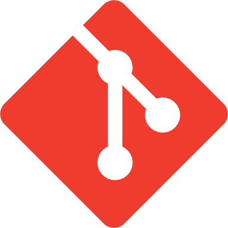

<p align="center">
  
</p>

<h1 align="center">Blamit</h1>

<p align="center">
  <b>Who wrote this line, and in which MR?</b><br>
  Git blame for the current line, one click away from the commit or the merge request.
</p>

<p align="center">
  <a href="https://open-vsx.org/extension/paul-pch/blamit"></a>
  
  
</p>

---

Blamit is what's left of GitLens once you remove everything but the blame. No side panels, no graphs, no account, no runtime dependencies.

## What it does

```
const total = items.reduce(sum, 0);      Jane Doe, 3 days ago • Fix rounding in totals
```

- **Inline blame** on the line under the cursor: author, date, commit message.
- **Hover** the annotation to see the full commit message and the links.
- **Open the commit or the MR/PR** in your browser from the hover, the Command Palette or the right-click menu.
- **Copy the SHA** in one click.

Works on GitHub, GitLab and Gitea/Forgejo, cloud or self-hosted, and it handles unsaved edits.

## Getting started

Install it, open a file in a git repository, put the cursor on a line. That's it.

Commands, all applied to the cursor line:

| Command | |
|---|---|
| `Blamit: Open Commit` | Opens the commit page |
| `Blamit: Open MR/PR` | Opens the merge/pull request that brought the line |
| `Blamit: Copy SHA` | Copies the full commit SHA |
| `Blamit: Set API Token` | Optional, see below |

## How the MR/PR is found

1. **Offline first.** Blamit reads the commit message (`Fix bug (#42)`, `See merge request group/project!12`), then the merge commit that brought it into your branch.
2. **API as a fallback**, only if you set a token for that host. Useful for rebased or fast-forwarded commits.

<details>
<summary>Token scopes</summary>

| Host | Scope |
|---|---|
| GitHub | Fine-grained: *Pull requests: read* (classic: `repo` for private repos) |
| GitLab | `read_api` |
| Gitea / Forgejo | `read:repository` |

Tokens are stored in VS Code's secret storage and only ever sent to their own host.
</details>

## Settings

| Setting | Default | |
|---|---|---|
| `blamit.enabled` | `true` | Show the inline blame |
| `blamit.remote` | `"origin"` | Remote used to build links |
| `blamit.hosts` | `{}` | Declare self-hosted instances and SSH aliases |

Blamit recognizes hosts whose name contains `github`, `gitlab`, `gitea` or `forgejo`. For anything else:

```json
"blamit.hosts": {
  "git.example.com": "gitea",
  "github-work": { "type": "github", "url": "https://github.com" }
}
```

## Security

- Uses the git executable resolved by VS Code's built-in Git extension.
- Disabled in untrusted workspaces, since git can run code configured by a repository.
- Logs: *Output* panel → *Blamit*.

## Languages

English, Français, Deutsch, Italiano, Español.

## License

MIT. The icon is the [Git logo](https://git-scm.com/downloads/logos) by Jason Long, licensed under [CC BY 3.0](https://creativecommons.org/licenses/by/3.0/).
